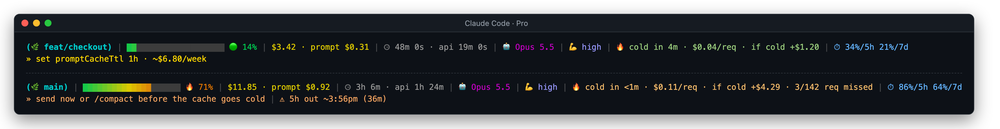
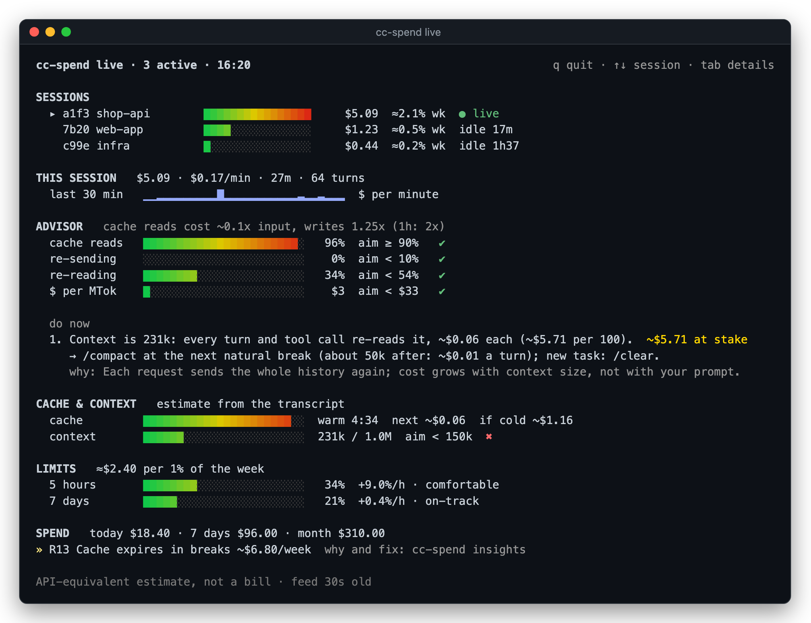
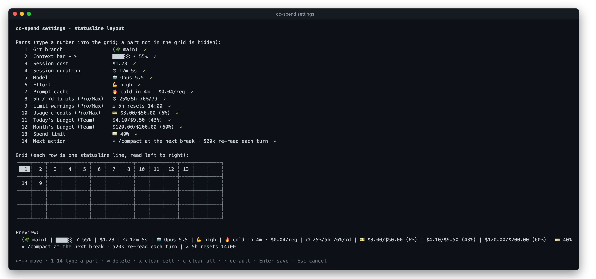
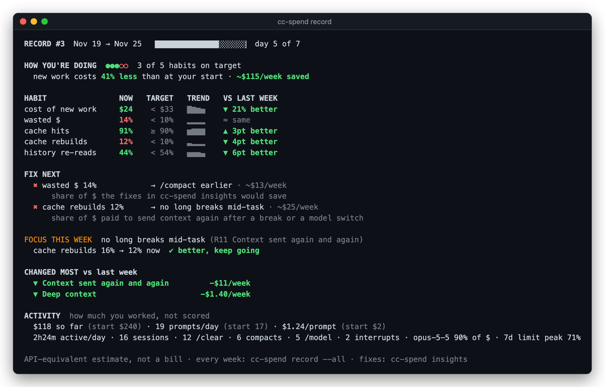

# cc-spend

**Know what every Claude Code prompt costs, while you work. Then spend less.**

Claude Code bills by tokens, and you rarely see the bill per prompt. The habits
that waste money stay hidden: a long session that re-reads everything, a cache
that goes cold over a coffee break, a premium model on easy work. cc-spend
puts the $ in your statusline, tells you what to change, and checks every week
if it worked.

```sh
npm install -g @gllamas/cc-spend && cc-spend init
```

Zero runtime dependencies. No server, no analytics, no message text stored.

## Pro / Max: your real limits, before you hit them



- The $ of this session and of the prompt you just sent.
- The prompt cache: when it goes cold, what the next request costs warm, and
  what it costs if you let it expire.
- Your real 5h and 7d limits, and when you will run out at this pace.
- One tip (`»`) with the $ it saves: the costliest habit, or what to do now.

## Team / Enterprise: a monthly budget, split over your work days


`$today/$max` and `$month/$cap`. cc-spend splits what is left of the cap
over the work days left, so a slow day gives you more tomorrow and a heavy
day gives you less. The cap comes from Anthropic when your org sets one.

## `cc-spend live`: every open session, and what to do now



A full-screen view next to Claude Code. Each session's $, a scorecard of
your habits, the one thing to do now with the $ at stake, the cache
countdown, and your limits. `Tab` shows where the $ went, bar by bar.

## `cc-spend calendar`: work days, daily max, history


For Team / Enterprise. Mark holidays and days off, and the daily max
re-splits. Look back at any day, open where its $ went (`d`), or correct it
(`u`).

## `cc-spend settings`: your statusline, your way



Pick which parts show and in what order: type a part's number into the
grid, one grid row per statusline line, and watch the preview change.
`r` resets to the default, `Enter` saves.

## Spend less, and prove it

1. **See.** The statusline shows the cost as you work.
2. **Change.** `cc-spend insights` ranks what costs you the most, with the
   $ and the exact fix.
3. **Check.** `cc-spend record` scores your habits week by week against
   your own baseline.

`record` needs no start or stop. The first week starts by itself, and the 7
days before it become your start. It scores how you work, not how much: a
busy week does not look worse.



Each week gets one focus (your costliest habit), and the advisor follows your
trend: a habit that got worse than last week moves to the top of `insights`
and of the statusline tip (`▲ up on last week`). `--all` lists every week,
`--days 14` changes the length.

## What `insights` checks

Each finding comes with its $ over the last 7 days (`--month` for 30), the
evidence, why it costs and the fix. `--rules` prints this list in the
terminal and marks the rules found now. Findings under $0.50 are hidden;
`--snooze R1 7d` hides one for a week.

| ID  | Finding                      | Why it costs                                                                                                  | Fix                                                                                                              |
| --- | ---------------------------- | ------------------------------------------------------------------------------------------------------------- | ---------------------------------------------------------------------------------------------------------------- |
| R1  | Subagents on a premium model | Subagents mostly search and read; a premium model bills the same tokens at 2-5x Sonnet.                       | CLAUDE_CODE_SUBAGENT_MODEL=sonnet, or model: in the agent file.                                                  |
| R2  | Fast mode                    | Fast mode bills every token at 2x the standard rate.                                                          | Turn fast mode off (/fast, setting fastMode=false).                                                              |
| R3  | High effort thinking         | Thinking bills as output, the most expensive token; high effort is enough for most tasks.                     | Use high effort by default (/effort, setting effortLevel=high).                                                  |
| R4  | Prompt cache re-paid         | After a miss the whole context is written again at 1.25-2x the input rate instead of read at about 0.05-0.1x. | /compact before a break; run long commands in the background; keep the MCP servers and tools stable mid-session. |
| R5  | Deep context                 | Every turn, each tool call included, re-reads the whole context; the part above 200k is paid each time.       | Auto-compact before 200k (/autocompact 200k), or start fresh for a new task.                                     |
| R6  | Outlier session              | One runaway session (a loop, a huge file, the wrong model) can cost more than a normal day.                   | cc-spend report week --by session, then report --session <id> to see what it did.                                |
| R7  | Unused MCP servers           | A server loads into every turn of every session, used or not.                                                 | Turn off servers a project does not use (/mcp) or remove them from .mcp.json.                                    |
| R8  | Running out early            | At the limit work stops until the reset; the cost is time, not $.                                             | Slow down, or move routine work to a cheaper model.                                                              |
| R9  | Older model                  | The newer model is at least as good for the same or a lower price.                                            | Switch with /model, and update the default model in your settings.                                               |
| R10 | Most spend re-reads context  | Long sessions spend most of their $ re-reading history, not producing new work.                               | /compact at natural breaks, /clear between unrelated tasks.                                                      |
| R11 | Context sent again and again | Context the model already had was sent again at write prices, often after a cold cache or a model switch.     | Avoid long mid-session breaks (/compact before one); do not switch models on a big context.                      |
| R12 | Large instruction files      | They load into every turn; each extra 1k tokens is paid on every turn of every session.                       | Trim them; move rare detail into files read on demand.                                                           |
| R13 | Cache expires in breaks      | The default cache lives 5 min; a 5-60 min break re-writes the whole context, a 1h cache would have read it.   | Set "promptCacheTtl": "1h" in the project's .claude/settings.json (or ~/.claude/settings.json for all).          |

All $ are API-equivalent estimates from your local transcripts, not a bill.
On Pro/Max each $ also shows as points of the 7-day limit, once cc-spend has
measured the $ per 1%.

## Commands

```sh
cc-spend init         # first-run setup
cc-spend statusline   # install or update the statusline
cc-spend insights     # what to change to spend less, with $ and the fix
cc-spend record       # how you're doing: habits vs target, last week and your start (--all, --days N)
cc-spend report       # where the $ went: trend, $ per day, bars by model, project, … (--by, --session <id>)
cc-spend live         # live view of every open session (Tab: details, q: quit)
cc-spend calendar     # work days, daily max, history (Team/Enterprise)
cc-spend settings     # choose and order the statusline parts
cc-spend doctor       # check Node, Claude Code, the statusline, hooks, files
cc-spend uninstall    # remove it and restore your old statusline
```

## Install

```sh
npm install -g @gllamas/cc-spend
cc-spend init
```

Needs Node 24+. Install it globally (`npx` is refused: Claude Code must point
at files that stay). `init` sets up the statusline; on Team/Enterprise it also
asks for your work days and cap. After that there is nothing to do: cc-spend
reads what Claude Code already writes. Each Claude account is tracked on its
own, under `~/.config/cc-spend/`.

## Privacy

No server, no analytics. The only network calls go to Anthropic's read-only
endpoints that Claude Code already uses (`/api/oauth/usage`,
`/api/oauth/profile`), with your Claude Code login, from a background process.

cc-spend reads your Claude Code transcripts in `~/.claude/projects` on this
machine. It keeps only numbers and names: tokens, $, model, project folder,
branch, session id and name, times, hook runs, MCP server names, and per day
how many prompts, `/clear`, `/compact` and `/model` you used. It reads the
size of your CLAUDE.md and MEMORY.md files. **No message text is stored, and
nothing is sent anywhere.**

## Development

```sh
pnpm install && pnpm build && pnpm test
```

The screenshots above come from the real renderers with made-up data.
